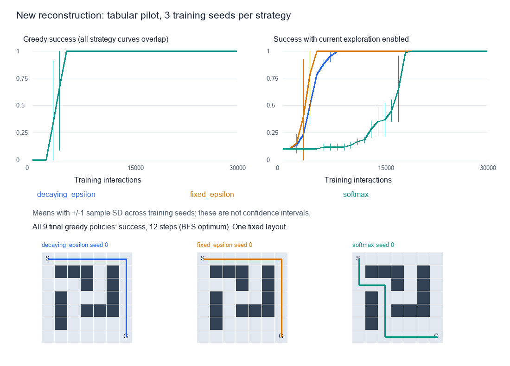

# Exploration Strategies in Reinforcement Learning

An empirical study of how exploration strategies affect learning progress and policy behavior. The current experiments compare fixed epsilon-greedy, decaying epsilon-greedy, and Boltzmann action selection in a sparse-reward navigation task.

## Experiment and pilot results

A tabular Q-learning agent navigates a grid with obstacles, a fixed start and goal, and a 60-step episode limit. Each strategy uses the same Q-learning update and a budget of 30,000 interactions per training seed. Breadth-first search (BFS) supplies the shortest-path reference.

The pilot uses three training seeds per strategy on one layout. It measures both the quality of the learned greedy policy and the behavior of the agent when exploration remains enabled. A larger study and deep-RL comparisons are planned.



All nine final greedy policies reached the goal in 12 steps, matching the shortest-path reference. With exploration enabled, final mean route lengths were 15.42 ± 0.46 steps for fixed epsilon, 12.95 ± 0.09 for decaying epsilon, and 12.98 ± 1.70 for Boltzmann selection. These values summarize three training seeds, with each policy evaluated over 20 episodes. The ± values are sample standard deviations across training seeds.

The [results report](docs/results_report.md) and [per-condition summary](results/figures/pilot/summary.md) discuss the findings and the limits of this small deterministic task. Raw runs, checkpoints, and the run source snapshot are included.

## Run locally on Windows

Python 3.12 or newer; **no third-party dependencies** for this stage. Clone the repository and work from its directory:

```powershell
git clone https://github.com/shamail-khan/exploration-strategies.git
cd exploration-strategies
```

Set `$python` to your Python executable. If `python` is available on PATH, use:

```powershell
$python = 'python'
& $python --version
& $python scripts/test.py
& $python scripts/run.py check --output results/environment_check_repeat
```

Open `results/environment_check_repeat/trajectories.html` to inspect the shortest-path reference and five random trajectories. Check uses a fresh output directory to preserve existing evidence. On Linux/macOS, run the same script arguments with `python3` instead of PowerShell's `& $python` prefix.

Train and evaluate one condition and seed (30,000 tabular interactions):

```powershell
& $python scripts/run.py train --condition decaying_epsilon --seed 0 --output results/example
& $python scripts/run.py evaluate --checkpoint results/example/decaying_epsilon/seed_0/checkpoint_0030000.json
```

Full pilot procedure (three conditions × three seeds):

```powershell
& $python scripts/run.py train --config configs/tabular_pilot.json --output results/pilot_repeat
& $python scripts/run.py plot --input results/pilot_repeat --output results/figures/pilot_repeat
```

The original pilot output already occupies `results/pilot`; the commands above write a repeat separately. Choose another fresh directory for subsequent repeats. Training refuses to overwrite an existing run. Optional installation: `python -m pip install -e .`; not required by the source runner.

To reproduce the plots from the included original runs without training:

```powershell
& $python scripts/run.py plot --input results/pilot --output results/figures/pilot
```

## Outputs and interpretation

Each run saves the complete configuration, training episodes, per-interaction exploration value and action entropy, evaluation metrics, all evaluation checkpoints, visitation counts, source fingerprint, interpreter/platform information, seed, timestamp and elapsed time. Checkpoints support loading for evaluation, **not training resumption**. Generated summaries and figures can be rebuilt from the recorded runs.

Primary evaluation disables exploration and runs a deterministic greedy policy in a separate environment. Secondary evaluation samples actions with the current exploration schedule and is reported separately. No evaluation updates the agent or consumes the training RNG. Success and return are equivalent in this sparse task; route length and visitation supply additional behavior information.

Plots show individual training seeds, means and descriptive ±1 sample SD bars. Evaluation episodes are not treated as independent training runs. Threshold and AUC definitions, time-limit handling, seed roles and limitations are specified in the [protocol](docs/experimental_protocol.md).

## Repository structure

- `src/exploration/`: environment, shared Q learner, evaluation, CLI and portable SVG/HTML diagnostics.
- `configs/`: complete experimental definitions.
- `tests/`: boundary, action-probability, evaluation-isolation, reproducibility and checkpoint checks.
- `results/`: raw pilots, environment checks and generated figures.
- `docs/`: [project history](docs/provenance.md), [protocol](docs/experimental_protocol.md), [report](docs/results_report.md), [method notes](docs/learning_notes.md).

## Planned extensions

- A main tabular study with five new training seeds per condition and finer evaluation intervals.
- Additional layouts to examine sensitivity to task structure.
- Within-algorithm deep-RL comparisons of epsilon schedules in DQN and entropy coefficients in PPO.

The current results cover tabular Q-learning. DQN and PPO experiments are planned. Boltzmann action selection and entropy-regularized policy optimization are distinct methods.
